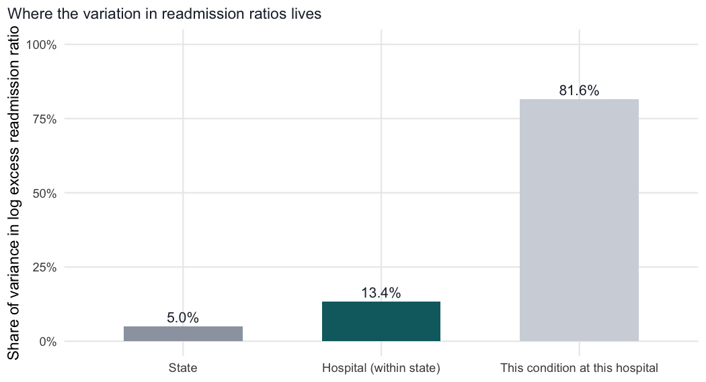
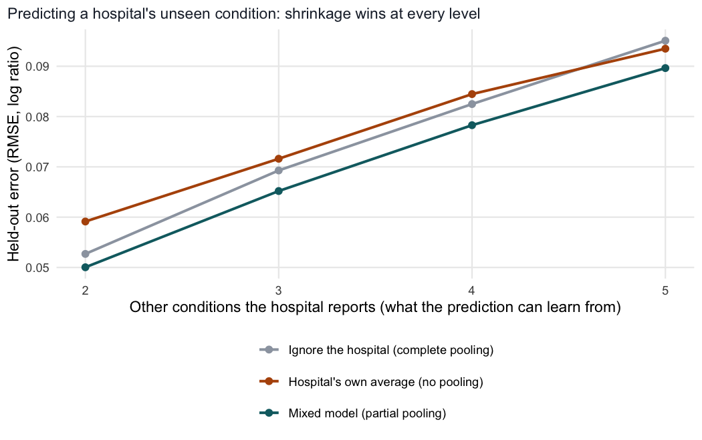
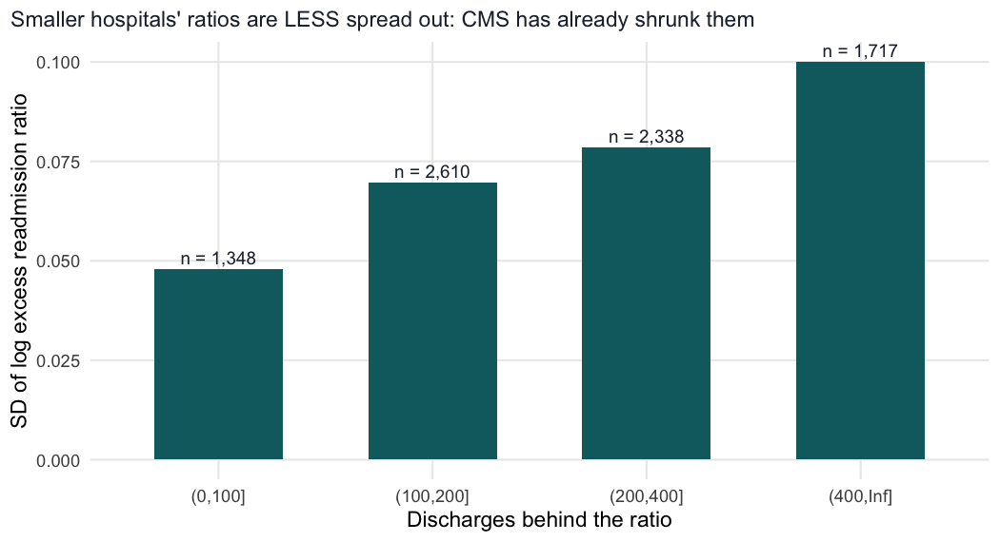

# Readmission Multilevel (R)

Medicare penalises hospitals whose patients are readmitted more than expected, condition by condition. **How much of that performance belongs to the hospital, how much to its state, and how much to the individual condition?** This project answers with **mixed-effects (multilevel) models in R**: 11,681 excess readmission ratios, from 2,818 hospitals in 51 states, covering six conditions each. It then tests whether "partial pooling" actually predicts better.

> **Status: learning project (September 2026).** It is built, tested (11 `testthat` tests), and run on the real CMS data, and I am still practising explaining it. It is my second R project, so R is a **learning** skill. The ratios describe Medicare's FY2026 readmission program (performance period July 2021 – June 2024). They are not measured quality of care, and nothing here is causal.



## Headline results

| Question | Answer |
|---|---|
| How much of the variation is the hospital? | **13.4%.** The state adds 5.0%, and **81.6%** is specific to the condition at that hospital |
| If a hospital does well on one condition, does it on another? | Only weakly: the correlation between two conditions at one hospital is **0.18** |
| Does that depend on the condition? | A lot. The hospital and state explain **41%** of COPD variation but only **4%** of hip/knee |
| Does partial pooling predict a hospital's unseen condition better? | **Yes, in all 5 random hold-outs.** RMSE 0.0738, against 0.0781 for ignoring the hospital and 0.0796 for the hospital's own average |
| Ownership (same condition and state)? | Non-profit ratios are **1.2% lower** than for-profit (p = 3 × 10⁻⁹). It's real, and small |

## The result I would lead with in an interview

Predicting a hospital's held-out condition from its others:

| Other conditions reported | Ignore the hospital | Hospital's own average | **Mixed model** |
|---:|---:|---:|---:|
| 2 | 0.0527 | 0.0591 | **0.0500** |
| 3 | 0.0693 | 0.0716 | **0.0652** |
| 4 | 0.0825 | 0.0845 | **0.0783** |
| 5 | 0.0951 | 0.0935 | **0.0896** |

With only 2–4 other conditions to go on, a hospital's own average is **worse than ignoring the hospital entirely**, because it chases noise. The mixed model shrinks that average toward the state and national levels in proportion to how much evidence it rests on, and it wins at every level.



## Something CMS's own method leaves in the data

If these ratios were raw rates, small hospitals would be the *noisiest*. They are the *least* spread out: the SD of the log ratio is 0.048 under 100 discharges and 0.100 over 400. CMS computes the ratios with its own hierarchical model, which already pulls small hospitals toward 1. So these ratios cannot identify outliers among small hospitals. Their extremes have been shrunk before the data is published.



## Quickstart

```bash
cd readmission-multilevel
Rscript -e 'install.packages("renv"); renv::restore()'   # exact package versions from renv.lock

Rscript tests/run_tests.R              # 11 tests, offline (~8 s)
Rscript scripts/run.R download         # 2 CMS files, SHA-256 verified (~3.5 MB)
Rscript scripts/run.R analyze          # models, hold-outs, figures -> outputs/ (~30 s)
```

The models use `nlme`, which ships with R, so nothing needs compiling beyond the tidyverse helpers. Details: [docs/results.md](docs/results.md) and [docs/how-it-works.md](docs/how-it-works.md).

## Data

These are CMS Provider Data Catalog files, pinned by URL and SHA-256. It is the same snapshot as the Python `hospital-quality-analytics` project:
- Hospital Readmissions Reduction Program FY2026 (9n3s-kdb3)
- Hospital General Information (xubh-q36u), used for state and ownership
