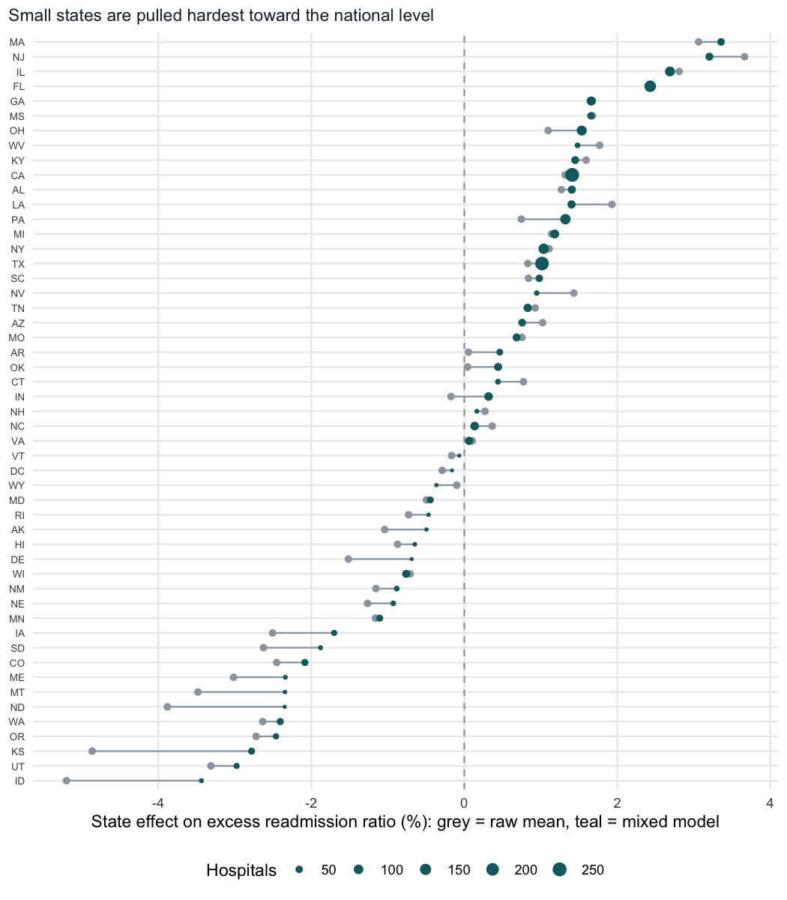

# Results — run of 2026-09-24

Produced by `Rscript scripts/run.R analyze` on the checksum-verified CMS files. The hold-out splits use seeds 1–5, so re-running reproduces every number.

## 1. The data

- 11,681 rows, each a hospital × condition pair with a reportable excess readmission ratio (ERR), from 2,818 acute care hospitals in 51 states (50 plus DC).
- Rows per condition: pneumonia 2,700, heart failure 2,610, COPD 2,318, heart attack (AMI) 1,732, hip/knee replacement 1,444, CABG 877.
- The outcome is **log(ERR)**. Ratios are multiplicative, and on the log scale 0.9 and 1.11 are the same distance from 1. Results are converted back to percent.

## 2. Where the variation lives

Model: log ERR ~ condition + ownership + (1 | state / hospital), fit by REML with one residual variance.

| Level | Variance | Share |
|---|---:|---:|
| State | 0.00034 | **5.0%** |
| Hospital, within state | 0.00090 | **13.4%** |
| Condition at hospital (residual) | 0.00548 | **81.6%** |

Adding each level is overwhelmingly supported by likelihood-ratio tests: adding the hospital level gives LR = 528.7 (p ≈ 5 × 10⁻¹¹⁷), and then adding the state level gives LR = 170.3 (p ≈ 6 × 10⁻³⁹). These p-values are conservative, because a variance tested at zero sits on the boundary of the parameter space.

**What the shares mean:**
- Two conditions at the same hospital correlate only **0.18**, and two hospitals in the same state correlate 0.05.
- Readmission performance is **mostly condition-specific**. A hospital that is good at heart failure is only somewhat more likely than average to be good at pneumonia.

## 3. One residual variance is wrong

Letting each condition have its own residual spread (`varIdent`) improves AIC from −26,040 to **−30,168**.

| Condition | Residual SD relative to CABG | Share of variance from hospital + state |
|---|---:|---:|
| COPD | 0.42 | **41.4%** |
| Heart failure | 0.60 | 26.0% |
| Pneumonia | 0.62 | 24.7% |
| Heart attack | 0.64 | 23.7% |
| CABG | 1.00 | 11.2% |
| Hip/knee | 1.67 | **4.3%** |

A hospital's hip/knee ratio is almost entirely condition-specific variation. Its COPD ratio carries the most signal about the hospital itself. This heteroscedastic model is the one used for ownership and for prediction.

## 4. Ownership

| vs for-profit (same condition and state) | Mixed model | p | OLS on the same rows |
|---|---:|---:|---:|
| Non-profit | **−1.2%** (SE 0.0020 log) | 3 × 10⁻⁹ | −1.8% (SE 0.0020) |
| Government | −0.9% (SE 0.0027) | 0.0008 | −1.5% (SE 0.0028) |
| Physician-owned (95 rows) | −3.5% (SE 0.0101) | 0.0004 | −6.8% (SE 0.0086) |

**What I expected and what I found.** I expected OLS, which treats a hospital's six rows as independent, to report much smaller standard errors. It didn't: the SEs are almost identical. That is consistent with the low hospital share (13%) and with this model's per-condition weighting. What *does* change is the size of the effect. OLS makes ownership look about 1.5–2× larger. The likely reasons, not tested separately, are that OLS ignores the clustering of hospitals within states whose levels differ, and that it weights every condition equally, including the noisy hip/knee rows. The mixed-model estimates are the ones to quote, and they are small.

## 5. Does partial pooling predict better?

**Design:**
- For every hospital with at least 3 reported conditions (2,385 hospitals), one condition is held out at random.
- The models are fit on everything else.
- Three predictions of the held-out ratio are compared: ignore the hospital, use the hospital's own average residual, or use the mixed model's partial-pooling prediction.
- This is repeated over 5 random hold-outs.

| Hold-out seed | Ignore the hospital | Own average | **Mixed model** |
|---:|---:|---:|---:|
| 1 | 0.0784 | 0.0792 | **0.0737** |
| 2 | 0.0788 | 0.0801 | **0.0745** |
| 3 | 0.0772 | 0.0787 | **0.0729** |
| 4 | 0.0749 | 0.0773 | **0.0705** |
| 5 | 0.0810 | 0.0825 | **0.0772** |
| **Mean** | 0.0781 | 0.0796 | **0.0738** |

The mixed model wins in every hold-out. The hospital's own average **loses to ignoring the hospital** in every hold-out, because with a correlation of only 0.18 between conditions, a hospital's other conditions are mostly noise when taken at face value.

By how many other conditions the hospital reports (pooled over the 5 hold-outs):

| Other conditions | Held-out rows | Ignore | Own average | Mixed |
|---:|---:|---:|---:|---:|
| 2 | 481 | 0.0527 | 0.0591 | **0.0500** |
| 3 | 597 | 0.0693 | 0.0716 | **0.0652** |
| 4 | 660 | 0.0825 | 0.0845 | **0.0783** |
| 5 | 647 | 0.0951 | 0.0935 | **0.0896** |

The own-average approach only overtakes "ignore" at 5 conditions, once there is more evidence to average. Errors grow with the number of conditions because hospitals that report all six are larger, and CMS shrinks larger hospitals' ratios less (section 7).

## 6. States: raw means vs partial pooling

This compares each state's raw effect (the plain mean of its hospitals' residuals) with the mixed model's estimate:
- **73%** of states moved toward zero.
- Small states (under 15 hospitals, 12 states) keep a median **62%** of their raw effect; larger states keep **91%**.
- The size of the pull correlates negatively with state size (Spearman −0.41).
- The spread of state effects narrows from an SD of 2.0% to 1.6%.

Not every state moves toward zero, because the pooled estimate also re-weights a state's hospitals by how much evidence each one carries.

**A comparison I got wrong first.** The first version compared an unweighted average of *rows* with the weighted, adjusted model estimate, and reported "shrink factors" such as 1.38 for Massachusetts. That was not a like-for-like shrinkage comparison. The second attempt used the ratio pooled/raw, which explodes when the raw effect is near zero (factors like 10.5 and −1.8). The version above compares hospital-weighted means from the same model form, and measures the pull as a difference.

## 7. CMS's shrinkage is visible in the data

| Discharges behind the ratio | Rows | SD of log ERR | 5th–95th percentile ERR |
|---|---:|---:|---|
| ≤ 100 | 1,348 | **0.048** | 0.961 – 1.114 |
| 101–200 | 2,610 | 0.070 | 0.917 – 1.134 |
| 201–400 | 2,338 | 0.079 | 0.881 – 1.128 |
| > 400 | 1,717 | **0.100** | 0.848 – 1.140 |

With raw rates, the smallest hospitals would be the most dispersed. Here they are the least, because CMS's ratio is built from its own hierarchical model, which pulls hospitals with little data toward 1. Two consequences:
1. A low-volume hospital's ratio near 1 is partly CMS's prior, not evidence that the hospital is average.
2. The hospital variance estimated above is a variance of *already-shrunk* quantities, so it understates true hospital-to-hospital differences.

(3,668 rows have suppressed discharge counts and are not in this table.)

## Known limits

- The ERRs are CMS model outputs, not raw outcomes. This is an analysis of how CMS's published measure behaves.
- There is no hospital size, teaching status, or case-mix data beyond what CMS's risk adjustment already includes.
- Ownership effects are associations, not causes.
- One program year, and one performance period (Jul 2021 – Jun 2024) that includes COVID-era months.
